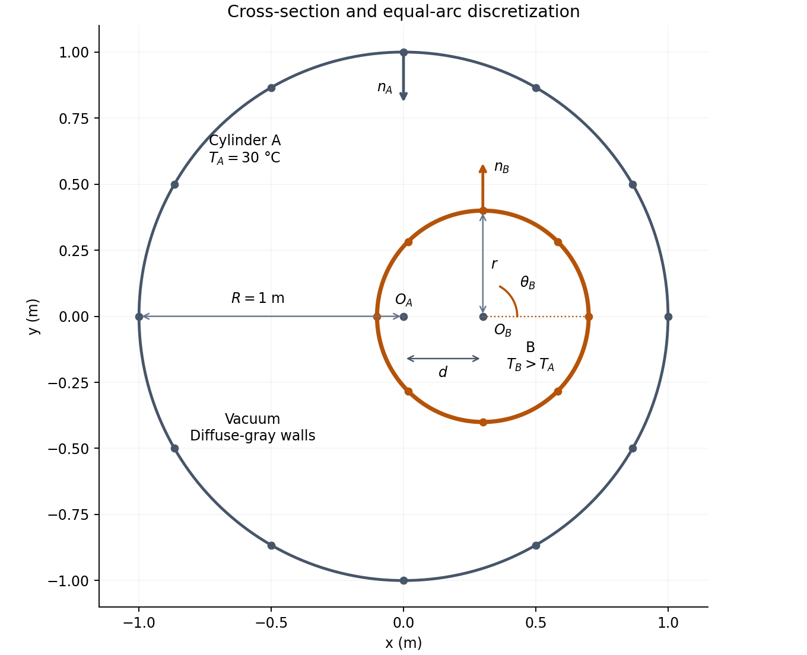
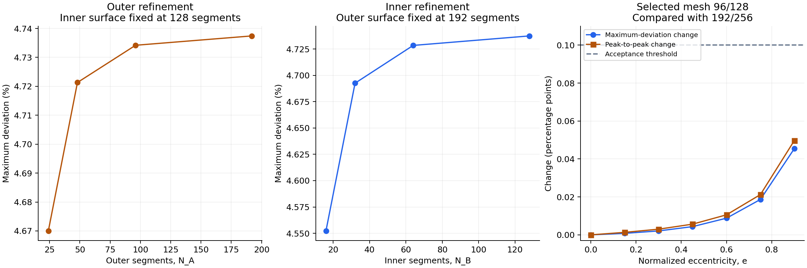
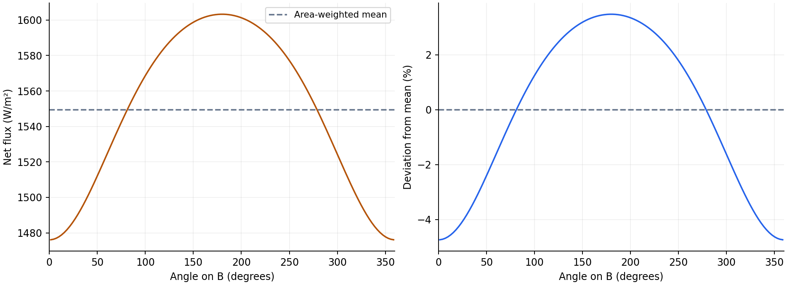
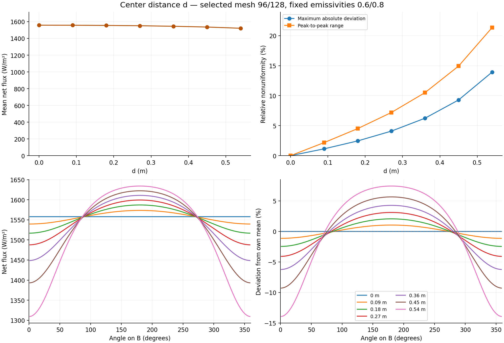
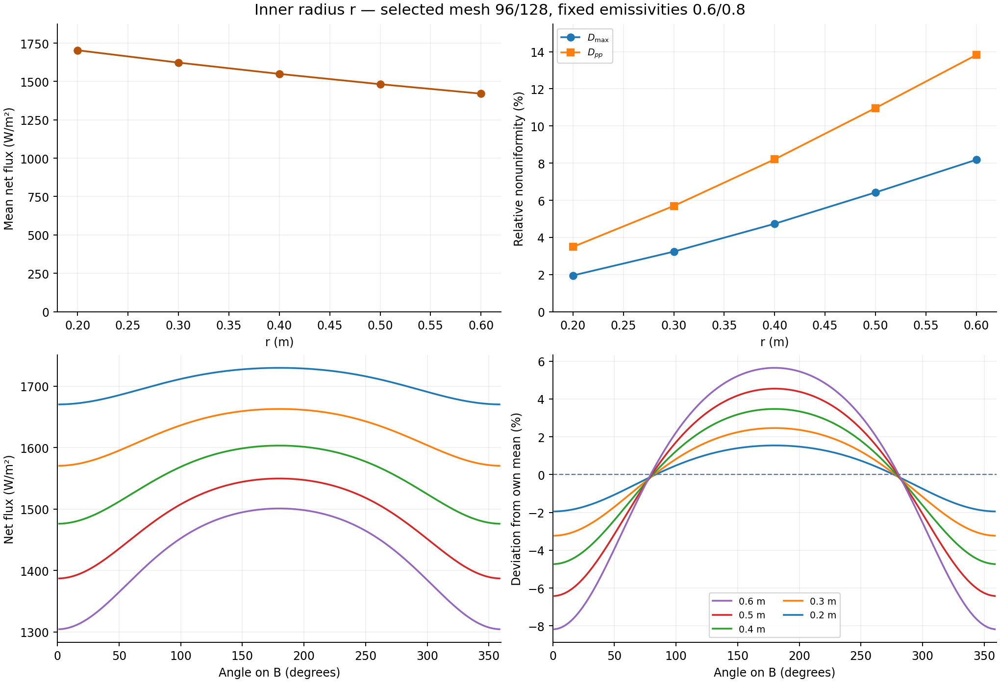
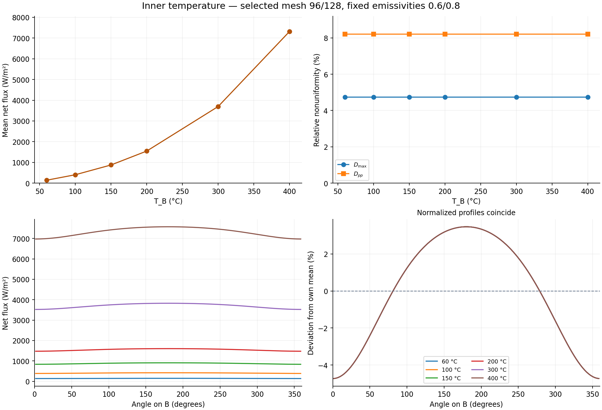

# Analysis of Radiative Heat Transfer Between Two Infinitely Long Cylinders in an Eccentric Arrangement

Sebastian Alberto Gajardo Lobos · Heat and Mass Transfer (Radiative Heat Transfer)

## Assignment statement

Inside an infinite cylinder A of radius $R = 1$ m, maintained at constant temperature $\vartheta_A = 30$ °C, a second, smaller infinite cylinder B of radius $r$, ($r < R$), is placed, which is also maintained on constant temperature $\vartheta_B > \vartheta_A$. Both cylinders are diffuse-gray bodies with emissivity coefficients $\varepsilon_A$ and $\varepsilon_B$ and the space between them is a vacuum.

If the cylinders are arranged concentrically or if both are black bodies, a heat flux density on the surface of cylinder B is uniform, however, if both cylinders are diffuse-gray bodies and the smaller cylinder B is placed at distance $d$, $0 < d < R - r$ from the centre of cylinder A, heat flux density on the cylinder B is not uniformly distributed.

The task is to analyse the deviation from uniform surface flux density when the cylinder B is placed eccentrically within the cylinder A, using a view factor method.


Temperature notation: $\vartheta_A$ and $\vartheta_B$ in the assignment are written as $T_A$ and $T_B$ in the report.

## The following is required

**(a)** For a selected combination of parameters $r$, $d$, and $\vartheta_B$, analyse the effect of discretizing the surfaces of cylinders A and B into equal segments (the number of elements on cylinders A and B need not be equal) on the deviation from uniform surface flux density on cylinder B. The analysis must include the derivation of the appropriate thermodynamic model for radiative heat transfer.

**(b)** Using the same thermodynamic model and the selected discretization, analyse the influence of parameters $r$, $d$, and $\vartheta_B$, on the deviation from uniform surface density of cylinder B.

**(c)** Supplement all analyses with appropriate descriptions, diagrams, and commentary, and compare the results with analytical solutions, if find appropriate.

## Objective and numerical scope

Quantify deviation from uniform net heat-flux density on cylinder B using view factors, derive the thermodynamic model, select a surface discretization, and study r, d and T_B. Descriptions, diagrams, discussion, raw results and the corresponding program code accompany the analyses. The agreed submission scope does not include comparison against analytical solutions.



Figure: working geometry. The displayed 12/8 segment boundaries illustrate the idea of equal-arc discretization; suitable calculation counts are assessed in the refinement study below.

### Symbols in the diagram

| Symbol | Meaning |
| --- | --- |
| $R$ | Radius of outer cylinder A: the distance from its center to its wall (m). |
| $r$ | Radius of inner cylinder B: the distance from its center to its surface (m). |
| $O_A$, $O_B$ | Center points of cylinders A and B. |
| $d$ | Distance between the two centers, $O_A$ and $O_B$ (m). |
| $T_A$, $T_B$ | Surface temperatures of cylinders A and B. |
| $\theta_B$ | Angular position of a point on B, measured counterclockwise from the right. 0° = right, 90° = top, 180° = left, 270° = bottom. It identifies where the local flux is calculated. |
| $n_A$ | Surface normal on A: a direction perpendicular to its wall, pointing inward into the gap. |
| $n_B$ | Surface normal on B: a direction perpendicular to its surface, pointing outward into the gap. |

The normal arrows show surface orientation. Their lengths do not represent heat-flux magnitude. The angle $\theta_B$ labels a position; it does not indicate cylinder rotation.


## Part (a): thermodynamic model

**Assignment requirement (a)**

> For a selected combination of parameters $r$, $d$, and $\vartheta_B$, analyse the effect of discretizing the surfaces of cylinders A and B into equal segments (the number of elements on cylinders A and B need not be equal) on the deviation from uniform surface flux density on cylinder B. The analysis must include the derivation of the appropriate thermodynamic model for radiative heat transfer.

### 1. Physical assumptions and geometry

| Term | Plain meaning |
| --- | --- |
| Infinitely long | We exclude effects near the ends of the cylinders. |
| Isothermal | Every location on a given cylinder has the same temperature. A and B can have different temperatures. |
| Prescribed temperature | The temperature is a specified input and is maintained at that value. |
| Opaque | Radiation cannot pass through the cylinder wall. |
| Diffuse | Emission and reflection follow a diffuse angular distribution, rather than mirror-like reflection. |
| Gray | Emissivity is treated as independent of radiation wavelength. |
| Uniform emissivity | A given cylinder has the same emissivity everywhere around its surface. |
| Temperature-independent emissivity | We keep emissivity unchanged when temperature changes. |

Cylinder A has prescribed radius $R=1$ m and temperature $T_A=303.15$ K (30 °C). Cylinder B has radius $0<r<R$ and prescribed $T_B>T_A$. Both surfaces are infinitely long, isothermal, opaque, diffuse-gray bodies with uniform, temperature-independent emissivities. The gap is a vacuum: only surface-to-surface radiation is included. There is no transient temperature equation because both temperatures are prescribed.

The center of A is $O_A=(0,0)$. The center of B is $O_B=(x_B,0)$, where $x_B=+d$ on the right or $-d$ on the left. The center distance $d=|x_B|$ satisfies $0<d<R-r$ for eccentric cases. The concentric case $d=0$ is retained as a numerical reference. Normalized eccentricity is $e=d/(R-r)$. Angles on B are measured counterclockwise from the fixed positive x-axis: 0° right, 90° top, 180° left and 270° bottom. Mirroring the position mirrors the flux profile without changing scalar heat rates or nonuniformity measures.

### 2. Surface discretization and units

Divide A and B into $N_A$ and $N_B$ equal angular arcs, allowing different counts on the two surfaces. Retain their exact circular geometry and approximate radiosity as constant on each arc. The angular widths and areas per unit axial length are

$$
\Delta\theta_A=\frac{2\pi}{N_A},\qquad
\Delta\theta_B=\frac{2\pi}{N_B},\qquad
a_A=R\Delta\theta_A,\qquad a_B=r\Delta\theta_B.
\tag{1}
$$

The $a_i$ have units m² per m of axial length (equivalently m). Flux density $q_i$ has units W/m²; heat rate per axial length $Q'$ has units W/m. These are different quantities, particularly when radius changes. The reported local numerical flux is an arc average, rather than an exact pointwise value.

### 3. Derivation of the diffuse-gray energy balance

For an opaque gray surface, absorptivity equals emissivity. Of the irradiation $G_i$ arriving at arc $i$, the absorbed fraction is $\epsilon_i G_i$ and the reflected fraction is $(1-\epsilon_i)G_i$. Thermal emission is $\epsilon_i\sigma T_i^4$, where $\sigma=5.670374419\times10^{-8}$ W/(m² K⁴). Temperatures in this expression are in kelvin.

The total outgoing radiosity is therefore

$$
J_i=
\underbrace{\epsilon_i\sigma T_i^4}_{\text{emitted by the surface}}
+\underbrace{(1-\epsilon_i)G_i}_{\text{reflected incoming radiation}}.
\tag{2}
$$

The view factor $F_{ij}$ is the fraction of diffuse radiation leaving arc $i$ that reaches arc $j$, accounting for visibility and obstruction by B. Reciprocity gives the incident-radiation relation

$$
G_i=\sum_jF_{ij}J_j.
\tag{3}
$$

Substituting (3) into (2):

$$
J_i=\epsilon_i\sigma T_i^4
+(1-\epsilon_i)\underbrace{\sum_jF_{ij}J_j}_{G_i}.
\tag{4}
$$

Rearranging (4):

$$
J_i-(1-\epsilon_i)\sum_jF_{ij}J_j=\epsilon_i\sigma T_i^4.
\tag{5}
$$

Equation (5) is written for every surface arc $i$. The equations are **coupled** because the outgoing radiation from one arc depends on radiation leaving other arcs. Radiation leaving B reaches A; some can be reflected back toward B and reflected again. These repeated exchanges link the unknown radiosities, so they must be solved together.

The equations are **linear in the unknown radiosities** $J_j$: these unknowns appear only to the first power, multiplied by known coefficients. The prescribed temperatures $T_i$ are known inputs, even though they appear to the fourth power.

**Matrix form**

Collecting (5) for all surface arcs gives (6). Here $I$ is the identity matrix, $F$ contains the view factors, $\mathcal E=\operatorname{diag}(\epsilon_i)$ stores the emissivities on its diagonal, and $\mathbf J$ is the list of unknown radiosities:

$$
\left[I-(I-\mathcal E)F\right]\mathbf J
=\mathcal E\sigma\mathbf T^4.
\tag{6}
$$

After solving (6), irradiation follows from (3), and the net outward flux is

$$
q_i=\epsilon_i(\sigma T_i^4-G_i)=J_i-G_i.
\tag{7}
$$

Positive $q_i$ means net heat leaves the body; the hotter B has positive net outward flux. Cylinder A absorbs the net heat transferred from B. Using areas per unit axial length,

$$
Q'_B=\sum_{i\in B}a_iq_i,\qquad
Q'_A=\sum_{i\in A}a_iq_i,\qquad Q'_A+Q'_B=0.
\tag{8}
$$

Diffuse-gray radiosity and irradiation are described in the [COMSOL surface-radiation theory reference](https://doc.comsol.com/6.3/doc/com.comsol.help.heat/heat_ug_theory.07.051.html). The sign convention here is positive outward.

### 4. View factors for infinitely long cylinders

**Symbols in equations (9) and (10)**

| Symbol | Meaning |
| --- | --- |
| $i$, $j$ | Labels for the emitting arc and receiving arc. |
| $p_i$, $p_j$ | Points on the emitting arc $i$ and receiving arc $j$. |
| $\rho$ | Distance between the two points in the cross-section (m). |
| $z$ | Separation between the points along the cylinder axis, perpendicular to the cross-section (m). |
| $\beta_i$, $\beta_j$ | Orientation: angles in the cross-section between the connecting line and the surface normals pointing into the vacuum. |
| $V(p_i,p_j)$ | Visibility: 1 when the points have an unobstructed connection and face each other; 0 otherwise. |
| $a_i$ | Area of arc $i$ per unit axial length (m²/m). |
| $F_{ij}$ | Fraction of diffuse radiation leaving arc $i$ that directly reaches arc $j$. |
| $ds_i$, $ds_j$ | Infinitesimal (arbitrarily small) arc-length elements on arcs $i$ and $j$ (m), summed by the double integral. |

The three-dimensional diffuse exchange kernel is $\cos\theta_i\cos\theta_j/(\pi s^2)$, where $s$ is the full distance between the points and $s^2=\rho^2+z^2$. Each projection of a transverse surface normal contributes $\rho/s$. Integration over the infinite axial direction yields the following result. Equation (9) accounts for receiving points along the entire cylinder length when calculating the view factor.

$$
\int_{-\infty}^{\infty}
\frac{\rho^2}{\pi(\rho^2+z^2)^2}\,dz=\frac{1}{2\rho}.
\tag{9}
$$

Using (9), the view-factor exchange per unit axial length is

$$
a_iF_{ij}=\int_{\mathrm{arc}\ i}\int_{\mathrm{arc}\ j}
V(p_i,p_j)\frac{\cos\beta_i\cos\beta_j}{2\rho}\,ds_j\,ds_i.
\tag{10}
$$

Cylinder A has inward-facing vacuum normals; B has outward-facing normals. The kernel is symmetric, giving reciprocity $a_iF_{ij}=a_jF_{ji}$. B is convex and has no self-view. A is concave and can see other parts of itself, including part of the same finite arc.

For a source point, let $\phi$ be emission direction relative to its vacuum-facing normal. Integrating the axial direction gives the directional weight $\cos\phi/2$ on $-\pi/2<\phi<\pi/2$. Divide this emitting half-plane at bearings to receiver-arc endpoints and tangent directions to B. The first receiver is unchanged within each resulting interval. Its weight is evaluated exactly as

$$
\int_{\phi_1}^{\phi_2}\frac{\cos\phi}{2}\,d\phi
=\frac{\sin\phi_2-\sin\phi_1}{2}.
\tag{11}
$$

A midpoint ray identifies the first intersected receiver in each interval. Tangent directions account for the shadow cast by B. Average the resulting directional factors over each source arc using adaptive Gauss-Kronrod quadrature (`scipy.integrate.quad_vec`, maximum norm). The integration tolerance controls this numerical integration and is assessed separately from the surface segment counts in the discretization study.

No row normalization, symmetrization or smoothing is applied to hide integration residuals. For this closed enclosure, checks include:

- Nonnegativity, $F_{ij}\geq 0$ **(a radiation fraction cannot be negative)**.
- Closure, $\sum_jF_{ij}=1$ **(all fractions leaving a patch must add to 1, or 100%, because the enclosure is closed)**.
- Reciprocity, $a_iF_{ij}=a_jF_{ji}$ **(the area-weighted geometrical exchange is consistent in both directions)**.

Passing these checks does not guarantee an accurate flux distribution around B. Accuracy is assessed by refining the surface discretization in the next section.

### 5. Measuring departure from uniform surface flux

Use the area-weighted mean on B, then compare every local arc-average flux to that same mean:

$$
\bar q_B=\frac{\sum_{i\in B}a_iq_i}{\sum_{i\in B}a_i},\qquad
\delta_i=100\frac{q_i-\bar q_B}{|\bar q_B|}.
\tag{12}
$$

The two reported relative nonuniformity measures are

$$
D_{\max}=\max_{i\in B}|\delta_i|,\qquad
D_{pp}=100\frac{q_{\max}-q_{\min}}{|\bar q_B|}.
\tag{13}
$$

Both are percentages. Differences between these metrics on two meshes are expressed in **percentage points**. Relative nonuniformity is undefined at effectively zero mean flux. Assignment cases use $T_B>T_A$ and have positive mean flux.

Uniformity means that the angular flux equals the current surface mean everywhere. Comparing against a separate concentric calculation answers a different question and is not used as the definition of nonuniformity here.

### 6. Temperature dependence and interpretation

With fixed geometry and emissivities, the radiosity system is linear in $\sigma T_A^4$ and $\sigma T_B^4$. A closed isothermal enclosure has zero net flux, so the model implies

$$
q_B(\theta)=\sigma(T_B^4-T_A^4)\,h(\theta; r,d,R,\epsilon_A,\epsilon_B).
\tag{14}
$$

Changing $T_B$ scales absolute flux but leaves the normalized angular profile unchanged under these assumptions. This model consequence is checked using the six numerical temperature cases in part (b).

Local net flux depends on both emission and irradiation from the whole enclosure, including diffuse reflections. It is not determined by local gap distance alone. The narrow-gap and wide-gap trends stated in the report refer to the calculated gray-surface cases.

### 7. Numerical checks and limits

- Closure, reciprocity, nonnegativity and enclosure energy balance check numerical consistency.
- Equal-temperature equilibrium and left/right reflection symmetry are tested at the public solver interfaces.
- Independent A/B surface refinement and separate integration-tolerance refinement establish finite-mesh stability for the stated study cases.
- Very narrow gaps, other radii or different emissivities can require additional refinement. A successful solve is not an accuracy guarantee for arbitrary inputs.
- Infinite isothermal cylinders omit end effects, participating media, material temperature dependence and transient energy storage. Interactive motion shows successive prescribed steady states.


## Part (a): discretization selection

**Assignment requirement (a)**

> For a selected combination of parameters $r$, $d$, and $\vartheta_B$, analyse the effect of discretizing the surfaces of cylinders A and B into equal segments (the number of elements on cylinders A and B need not be equal) on the deviation from uniform surface flux density on cylinder B. The analysis must include the derivation of the appropriate thermodynamic model for radiative heat transfer.

### Working parameters

| Parameter | Baseline | Reason |
| --- | --- | --- |
| Outer radius R | 1 m | Prescribed by the assignment |
| Outer temperature T_A | 30 C | Prescribed by the assignment |
| Inner radius r | 0.4 m | Leaves room to vary radius and offset independently |
| Offset d | 0.3 m | e = 0.5; minimum gap 0.3 m, maximum gap 0.9 m |
| Inner temperature T_B | 200 C | A working hot-cylinder case above T_A |
| Emissivities epsilon_A / epsilon_B | 0.6 / 0.8 | Explicit gray-surface working assumptions, allowing diffuse reflections; no particular material is claimed |

Final one-parameter sweeps: e = 0, 0.15, 0.30, 0.45, 0.60, 0.75, 0.90 at r = 0.4 m; r = 0.2, 0.3, 0.4, 0.5, 0.6 m at fixed d = 0.3 m; T_B = 60 to 400 C at baseline geometry. Fix both emissivities throughout. The minimum gap among these geometry points is 0.06 m. The concentric point is a numerical boundary check and a useful starting point for the eccentricity sweep.

### Independent baseline refinement

The outer surface was refined through 24, 48, 96 and 192 segments with the inner surface held at 128. The inner surface was refined through 16, 32, 64 and 128 segments with the outer surface held at 192. This separates their effects; both surfaces were not simply increased together.

| Refinement | Maximum-deviation change (percentage points) | Peak-to-peak change (percentage points) |
| --- | ---: | ---: |
| outer_24_128 to outer_48_128 | 0.051272 | 0.064188 |
| outer_48_128 to outer_96_128 | 0.012871 | 0.016035 |
| outer_96_128 to outer_192_128 | 0.003233 | 0.004028 |
| inner_192_16 to inner_192_32 | 0.140154 | 0.181613 |
| inner_192_32 to inner_192_64 | 0.035871 | 0.046180 |
| inner_192_64 to outer_192_128 | 0.009021 | 0.011595 |

The inner 16-to-32 refinement fails the 0.1 percentage-point criterion. Finer meshes stabilize. Although the baseline alone permits smaller grids, the choice must also cover the larger offsets in part (b).

### Qualification across the study points

Accept changes below 0.5% in the maximum difference of interpolated flux profiles, and below 0.1 percentage points in both maximum relative deviation and peak-to-peak relative range. Normalize profile differences by the refined grid's mean inner flux. Periodic interpolation uses a shared 4096-angle grid and segment averages; it is a comparison method, not an exact pointwise solution.

Each of the 12 distinct geometry points was compared at 96/128 and 192/256 segments. All pass the three criteria.

| Study point | e | Profile change (%) | Max-deviation change (pp) | Peak-to-peak change (pp) |
| --- | ---: | ---: | ---: | ---: |
| baseline | 0.500 | 0.005695 | 0.005491 | 0.006929 |
| eccentricity_0 | 0.000 | 0.000000 | 0.000000 | 0.000000 |
| eccentricity_1 | 0.150 | 0.000800 | 0.000787 | 0.001313 |
| eccentricity_2 | 0.300 | 0.002126 | 0.002070 | 0.002994 |
| eccentricity_3 | 0.450 | 0.004494 | 0.004342 | 0.005641 |
| eccentricity_4 | 0.600 | 0.009133 | 0.008783 | 0.010556 |
| eccentricity_5 | 0.750 | 0.019427 | 0.018657 | 0.021227 |
| eccentricity_6 | 0.900 | 0.047166 | 0.045451 | 0.049711 |
| radius_0 | 0.375 | 0.001987 | 0.001891 | 0.002530 |
| radius_1 | 0.429 | 0.003578 | 0.003429 | 0.004453 |
| radius_3 | 0.600 | 0.008398 | 0.008140 | 0.009991 |
| radius_4 | 0.750 | 0.011441 | 0.011134 | 0.013361 |

### Why the inner grid was increased from 64 to 128

At e = 0.9, the coarser 96/64 mesh passes comparison with 192/128. Its peak-to-peak range nevertheless differs from the additional 384/256 reference by 0.102032 percentage points, just above the threshold. Increasing the inner grid to 128 reduces the difference to 0.059172 percentage points and the profile difference to 0.056176%. This additional check avoids relying on a marginal first comparison.

### Integration and temperature checks

At 96/64 baseline resolution, tightening source integration from 1e-6 through 1e-9 changes the nonuniformity metrics by less than 2e-9 percentage points between successive tolerances. At the selected 96/128 resolution, a 1e-8 versus 1e-9 check was also run at the baseline and at e = 0.9.

- baseline: profile change 1.658e-11%; peak-to-peak change 1.274e-11 percentage points.
- high_eccentricity: profile change 2.629e-10%; peak-to-peak change 2.937e-11 percentage points.

Temperature checks at 60, 200 and 400 C, for both baseline and e = 0.9 geometry, leave the normalized nonuniformity unchanged to approximately 2e-12 percentage points. This agrees with the linear fixed-emissivity model: temperature scales absolute flux through the difference in fourth powers. It does not justify temperature-independent results if material emissivity varies with temperature.

Across the selected-mesh qualification and reference cases, the maximum relative enclosure energy imbalance is 4.470e-12, maximum row-closure residual is 7.883e-15, and maximum scaled reciprocity residual is 5.773e-08.

### Decision based on the refinement evidence

Use **96 equal angular segments on cylinder A and 128 on cylinder B**, with source-arc integration tolerance **1e-8**, for the documented final parameter-study points. This is a recommended study setting; the interactive app keeps Preview and Custom resolutions available.

### Selected-mesh baseline result

- Mean inner flux: 1549.473679 W/m^2.
- Maximum relative deviation: 4.734188%.
- Peak-to-peak relative range: 8.206598%.
- Heat from B per unit length: 3894.252103 W/m.

### Scope and reproducibility

The selection is supported at the specified geometry points with emissivities 0.6/0.8. It is not a rigorous error bound, a proof for all continuous intermediate values, or qualification of arbitrary radius/offset/emissivity combinations. The site remains interactive; user-selected cases outside the documented points can be checked using independent refinement.

The numerical scope follows the requested assignment requirements. The interpretation of all three required parameter studies is presented in PARAMETERS.md.

Run the following from the repository directory (local caches in tmp/ make repeat runs faster):

```powershell
python run_discretization.py --stage independent
python run_discretization.py --stage worst-case
python run_discretization.py --stage qualify --outer 96 --inner 128
python run_discretization.py --stage support --outer 96 --inner 128
python finalize_discretization.py
python plot_discretization.py
```

Raw case tables, angular profiles, comparison tables, source fingerprints, and selected settings are stored in results/discretization/. The completed parameter studies use this selected mesh; see PARAMETERS.md and REPORT.md.






## Part (b): influence of physical parameters

**Assignment requirement (b)**

> Using the same thermodynamic model and the selected discretization, analyse the influence of parameters $r$, $d$, and $\vartheta_B$, on the deviation from uniform surface density of cylinder B.

All cases use N_A = 96, N_B = 128, source integration tolerance 1e-8, R = 1 m, T_A = 30 C, epsilon_A = 0.6 and epsilon_B = 0.8. Only the named parameter changes within each study. All reported q values are segment averages.

### Center distance d

At fixed r = 0.4 m and T_B = 200 °C, increasing d from 0.00 to 0.54 m increases maximum relative deviation from approximately zero to 13.933%. The peak-to-peak range reaches 21.358%, while mean flux changes from 1558.02 to 1521.27 W/m². The concentric point is a numerical reference; the other points are eccentric cases. For these gray-surface parameters, the narrow-gap side loses less net heat per area than the wide-gap side. A has uniform temperature but nonuniform radiosity because it also reflects the nonuniform irradiation from B. In these cases the near side of B receives more returning irradiation, reducing its net outward flux through q = epsilon_B (sigma T_B^4 - G_B). This is a coupled enclosure result, rather than a universal rule based on distance alone.

| r (m) | d (m) | T_B (C) | Mean q (W/m^2) | Max deviation (%) | Peak-to-peak (%) | Q'_B (W/m) |
| ---: | ---: | ---: | ---: | ---: | ---: | ---: |
| 0.4 | 0 | 200 | 1558.016783 | 0.000000 | 0.000000 | 3915.723263 |
| 0.4 | 0.09 | 200 | 1557.320269 | 1.138305 | 2.179610 | 3913.972733 |
| 0.4 | 0.18 | 200 | 1555.150222 | 2.459528 | 4.513215 | 3908.518811 |
| 0.4 | 0.27 | 200 | 1551.242856 | 4.089777 | 7.192051 | 3898.698528 |
| 0.4 | 0.36 | 200 | 1545.072639 | 6.237372 | 10.500921 | 3883.191083 |
| 0.4 | 0.45 | 200 | 1535.673935 | 9.281182 | 14.926887 | 3859.569562 |
| 0.4 | 0.54 | 200 | 1521.265304 | 13.933297 | 21.358301 | 3823.356722 |



### Inner radius r

At fixed d = 0.3 m and T_B = 200 °C, increasing r from 0.2 to 0.6 m increases maximum relative deviation from 1.948% to 8.181%. Mean flux decreases from 1703.45 to 1420.67 W/m². The total heat per unit length changes from 2140.62 to 5355.81 W/m because the circumference also changes. Holding d fixed makes normalized eccentricity increase from 0.375 to 0.750; the minimum gap decreases from 0.50 to 0.10 m. These conclusions describe radius variation at fixed center distance, not at fixed normalized eccentricity.

| r (m) | d (m) | T_B (C) | Mean q (W/m^2) | Max deviation (%) | Peak-to-peak (%) | Q'_B (W/m) |
| ---: | ---: | ---: | ---: | ---: | ---: | ---: |
| 0.2 | 0.3 | 200 | 1703.454772 | 1.948488 | 3.490679 | 2140.624399 |
| 0.3 | 0.3 | 200 | 1622.909791 | 3.233448 | 5.696237 | 3059.112885 |
| 0.4 | 0.3 | 200 | 1549.473679 | 4.734188 | 8.206598 | 3894.252103 |
| 0.5 | 0.3 | 200 | 1482.288631 | 6.421594 | 10.968284 | 4656.747072 |
| 0.6 | 0.3 | 200 | 1420.672289 | 8.180997 | 13.827983 | 5355.808353 |



### Inner temperature

At fixed r = 0.4 m and d = 0.3 m, raising T_B from 60 to 400 °C increases mean flux from 144.00 to 7320.48 W/m² (a factor of 50.84). Maximum relative deviation remains 4.734188%: its observed range is 1.18e-12 percentage points. With fixed geometry and temperature-independent emissivities, the linear radiosity equations scale absolute flux with the difference of fourth powers of temperature. The normalized angular shape therefore remains unchanged. This does not apply automatically to materials whose emissivity changes with temperature.

| r (m) | d (m) | T_B (C) | Mean q (W/m^2) | Max deviation (%) | Peak-to-peak (%) | Q'_B (W/m) |
| ---: | ---: | ---: | ---: | ---: | ---: | ---: |
| 0.4 | 0.3 | 60 | 144.004152 | 4.734188 | 8.206598 | 361.921909 |
| 0.4 | 0.3 | 100 | 406.862619 | 4.734188 | 8.206598 | 1022.557293 |
| 0.4 | 0.3 | 150 | 878.070690 | 4.734188 | 8.206598 | 2206.832344 |
| 0.4 | 0.3 | 200 | 1549.473679 | 4.734188 | 8.206598 | 3894.252103 |
| 0.4 | 0.3 | 300 | 3698.399508 | 4.734188 | 8.206598 | 9295.091780 |
| 0.4 | 0.3 | 400 | 7320.483414 | 4.734188 | 8.206598 | 18398.381531 |



### Numerical consistency

Across the 19 baseline/study cases, maximum relative energy imbalance is 1.690e-12, maximum view-factor closure residual is 5.773e-15, and maximum scaled reciprocity residual is 5.605e-08. These are consistency checks; mesh selection also uses finite-refinement comparisons.

Reproduce with `python run_assignment.py`. Source fingerprints and raw tables are in results/studies/manifest.json, cases.csv and profiles.csv.


## Part (c): discussion and conclusions

**Assignment requirement (c)**

> Supplement all analyses with appropriate descriptions, diagrams, and commentary, and compare the results with analytical solutions, if find appropriate.

1. The diffuse-gray radiosity model produces a nonuniform q profile in the eccentric baseline: mean q = 1549.473679 W/m², maximum relative deviation = 4.734188% and peak-to-peak range = 8.206598%.
2. Independent refinement of the two surfaces is necessary: stable total heat alone does not establish resolution of local nonuniformity. The selected 96/128 mesh passes the documented profile and metric-change criteria at all 12 geometry points, with an additional high-eccentricity check.
3. At the stated fixed emissivities, increasing center distance or increasing radius at fixed center distance increases relative nonuniformity over the studied ranges. The two variations change enclosure geometry in different ways.
4. Increasing prescribed inner temperature increases absolute flux, while normalized nonuniformity remains unchanged under the temperature-independent-emissivity model.
5. Interactive motion and playback display successive steady states, not physical transient heating. Mirroring B across the y-axis mirrors its flux profile without changing scalar heat-rate or nonuniformity measures.

## Limitations

The finite-mesh criteria are practical differences between meshes, not rigorous bounds on the exact solution. Qualification applies to the listed geometry points and fixed emissivities. Arbitrary near-contact or different-emissivity explorations need their own convergence assessment. Prescribed isothermal infinite cylinders omit end effects, participating media and transient energy storage.

## Code and reproduction

The downloadable submission package contains this report, all figures and tables used here, the numerical module, study runners, website source, tests, requirements and a file-hash manifest. From its root directory:

```powershell
python -m pip install -r requirements-dev.txt
python -m pytest -q
python run_assignment.py
python -m streamlit run streamlit_app.py
```

Numerical solver SHA-256: `d7215049ac5fbece16e4a613b32ec29ed5aaaa28056abb09556b794f455d6efb`.
